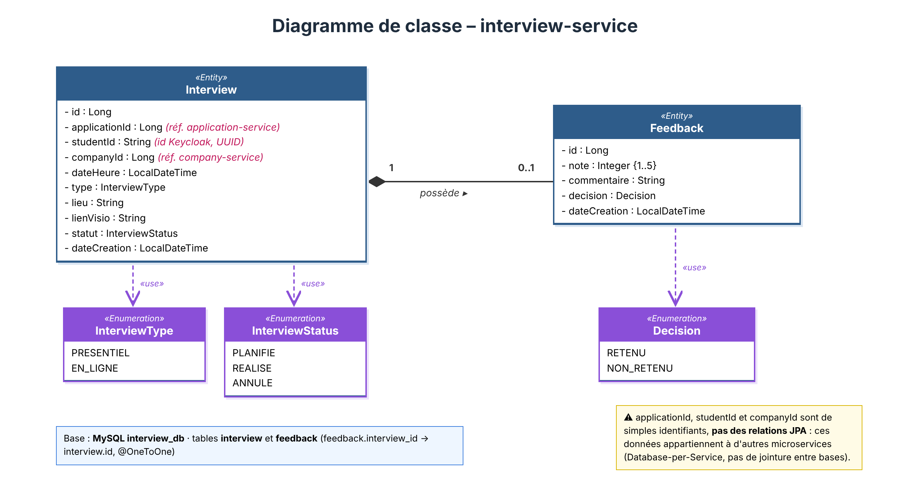

# interview-service – Documentation technique

## 1. Responsabilité

Le microservice **interview-service** gère la **planification des entretiens** après une candidature acceptée, leur **suivi** (statut) et le **feedback** de l'entreprise après l'entretien.

Il ne réalise pas l'entretien lui-même (pas de visioconférence) : il enregistre la date, le type (présentiel / en ligne), le lieu ou le lien de visio, puis le résultat.

- **Bounded Context** : Entretien
- **Technologie** : Spring Boot
- **Port** : 8086
- **Nom Eureka** : `INTERVIEW-SERVICE`

## 2. Modèle de données



### Entités

**Interview**

| Attribut | Type | Description |
|---|---|---|
| id | Long | Identifiant |
| applicationId | Long | Référence de la candidature (application-service) |
| studentId | String | Identifiant de l'étudiant (Keycloak, UUID) |
| companyId | Long | Référence de l'entreprise (company-service) |
| dateHeure | LocalDateTime | Date et heure de l'entretien |
| type | InterviewType | PRESENTIEL / EN_LIGNE |
| lieu | String | Adresse (si présentiel) |
| lienVisio | String | Lien Meet/Teams/Zoom (si en ligne) |
| statut | InterviewStatus | PLANIFIE / REALISE / ANNULE |
| dateCreation | LocalDateTime | Date de création |

**Feedback**

| Attribut | Type | Description |
|---|---|---|
| id | Long | Identifiant |
| note | Integer {1..5} | Note de 1 à 5 |
| commentaire | String | Commentaire de l'entreprise |
| decision | Decision | RETENU / NON_RETENU |
| dateCreation | LocalDateTime | Date de création |

**Relation** : `Interview` 1 —— 0..1 `Feedback` (composition, `@OneToOne`).

**Enums** : `InterviewType`, `InterviewStatus`, `Decision`.

> `applicationId`, `studentId` et `companyId` sont de **simples identifiants**, pas des relations JPA ni des clés étrangères : ces données appartiennent à d'autres microservices (**Database-per-Service**). La cohérence est vérifiée par appel API, pas par la base.

## 3. Base de données

- **SGBD** : MySQL
- **Base** : `interview_db` (privée, aucun autre service n'y accède)
- **Tables** : `interview`, `feedback` (`feedback.interview_id → interview.id`)
- **Justification** : données structurées et relationnelles (dates, statuts, relation Interview–Feedback), besoin de cohérence transactionnelle locale.

## 4. API REST

Base URL (via API Gateway) : `http://localhost:8080/api/interviews`

### Ressource Interview

| Méthode | URI | Body | Succès | Erreurs |
|---|---|---|---|---|
| POST | `/api/interviews` | InterviewRequest | 201 Created | 400, 404, 503 |
| GET | `/api/interviews` | – | 200 OK | – |
| GET | `/api/interviews/{id}` | – | 200 OK | 404 |
| GET | `/api/interviews/application/{applicationId}` | – | 200 OK | – |
| GET | `/api/interviews/student/{studentId}` | – | 200 OK | – |
| GET | `/api/interviews/company/{companyId}` | – | 200 OK | – |
| PUT | `/api/interviews/{id}` | InterviewRequest | 200 OK | 400, 404 |
| PATCH | `/api/interviews/{id}/status` | `{ "statut": "REALISE" }` | 200 OK | 400, 404 |
| DELETE | `/api/interviews/{id}` | – | 204 No Content | 404 |

### Sous-ressource Feedback

| Méthode | URI | Body | Succès | Erreurs |
|---|---|---|---|---|
| POST | `/api/interviews/{id}/feedback` | FeedbackRequest | 201 Created | 400, 404, 409 |
| GET | `/api/interviews/{id}/feedback` | – | 200 OK | 404 |

### Codes d'erreur

| Code | Cas |
|---|---|
| 400 Bad Request | Données invalides, candidature non acceptée, transition de statut invalide, feedback sur un entretien non réalisé |
| 404 Not Found | Entretien ou candidature introuvable |
| 409 Conflict | Un feedback existe déjà pour cet entretien |
| 503 Service Unavailable | application-service indisponible (circuit breaker) |

### Exemples

```json
// POST /api/interviews  (InterviewRequest)
{
  "applicationId": 12,
  "dateHeure": "2026-11-20T10:00:00",
  "type": "EN_LIGNE",
  "lienVisio": "https://meet.google.com/abc-xyz"
}

// 201 Created  (InterviewResponse)
{
  "id": 5,
  "applicationId": 12,
  "studentId": "a1b2c3d4-...",
  "companyId": 3,
  "dateHeure": "2026-11-20T10:00:00",
  "type": "EN_LIGNE",
  "lienVisio": "https://meet.google.com/abc-xyz",
  "statut": "PLANIFIE"
}

// POST /api/interviews/5/feedback  (FeedbackRequest)
{
  "note": 4,
  "commentaire": "Bon niveau technique",
  "decision": "RETENU"
}
```

### Règles métier

- Un entretien est créé **uniquement si la candidature est ACCEPTÉE** (vérification par OpenFeign). `studentId` et `companyId` sont récupérés de la réponse.
- `lieu` est obligatoire si `type = PRESENTIEL`, `lienVisio` est obligatoire si `type = EN_LIGNE`.
- Transitions de statut : `PLANIFIE → REALISE` ou `PLANIFIE → ANNULE` (pas de retour en arrière).
- Un feedback n'est possible que si `statut = REALISE`, et un seul par entretien.

### Documentation Swagger

Générée automatiquement avec `springdoc-openapi` : `http://localhost:8086/swagger-ui.html`

## 5. Interactions avec les autres microservices

| Sens | Service | Mode | Données échangées | Justification |
|---|---|---|---|---|
| Appelle | application-service | **Synchrone** (OpenFeign, REST) | `GET /api/applications/{id}` → id, statut, studentId, companyId | Besoin de la réponse avant de créer l'entretien |
| Consomme | application-service | **Asynchrone** (RabbitMQ) | événement `application.accepted` (applicationId, studentId, companyId) | Être informé qu'une candidature peut donner lieu à un entretien |
| Publie | application-service | **Asynchrone** (RabbitMQ) | événement `interview.scheduled` (interviewId, applicationId, dateHeure) | Annoncer un fait sans attendre de réponse ; application-service met le statut à "ENTRETIEN_PLANIFIÉ" |
| Appelé par | Frontend (via API Gateway) | Synchrone (REST) | Interview, Feedback | Consultation et gestion des entretiens |

Règle appliquée : **synchrone** si l'appelant a besoin de la réponse pour continuer, **asynchrone** pour annoncer un fait.

### Cas de panne

- **application-service indisponible** : l'appel OpenFeign est protégé par un **circuit breaker (Resilience4j)** avec un fallback. Le service répond **503** « Service candidature indisponible, réessayez plus tard » et l'entretien n'est pas créé. La panne ne se propage pas au reste du système.
- **RabbitMQ / consommateur indisponible** : le message `interview.scheduled` reste dans la file et sera traité au redémarrage (découplage temporel).

## 6. Sécurité (Keycloak)

| Rôle | Droits |
|---|---|
| ENTREPRISE | Créer, modifier, annuler un entretien, ajouter le feedback |
| ETUDIANT | Consulter ses propres entretiens |
| ADMIN | Tout consulter |

Le jeton JWT est vérifié par l'API Gateway puis par le service (Resource Server).

## 7. Configuration et architecture

### Dépendances

Spring Web, Spring Data JPA, MySQL Driver, Eureka Discovery Client, Config Client, OpenFeign, Resilience4j, Spring AMQP (RabbitMQ), OAuth2 Resource Server, Validation, Lombok, `springdoc-openapi-starter-webmvc-ui`.

### application.properties (exemple)

```properties
spring.application.name=interview-service
server.port=8086
spring.config.import=optional:configserver:http://localhost:8888

spring.datasource.url=jdbc:mysql://localhost:3306/interview_db?createDatabaseIfNotExist=true
spring.datasource.username=root
spring.datasource.password=
spring.jpa.hibernate.ddl-auto=update

eureka.client.service-url.defaultZone=http://localhost:8761/eureka

spring.rabbitmq.host=localhost
spring.rabbitmq.port=5672

spring.security.oauth2.resourceserver.jwt.issuer-uri=http://localhost:8180/realms/stages
```

### Route dans l'API Gateway

```properties
spring.cloud.gateway.routes[0].id=interview-service
spring.cloud.gateway.routes[0].uri=lb://INTERVIEW-SERVICE
spring.cloud.gateway.routes[0].predicates[0]=Path=/api/interviews/**
```

### Structure du projet

```
Backend/interview-service/
└── src/main/java/.../interviewservice/
    ├── entity/        Interview, Feedback, enums
    ├── repository/    InterviewRepository, FeedbackRepository
    ├── service/       InterviewService, FeedbackService
    ├── controller/    InterviewController
    ├── client/        ApplicationClient (OpenFeign) + fallback
    ├── messaging/     publisher / listener RabbitMQ
    ├── dto/           InterviewRequest, InterviewResponse, FeedbackRequest
    └── exception/     GlobalExceptionHandler, ResourceNotFoundException
```
