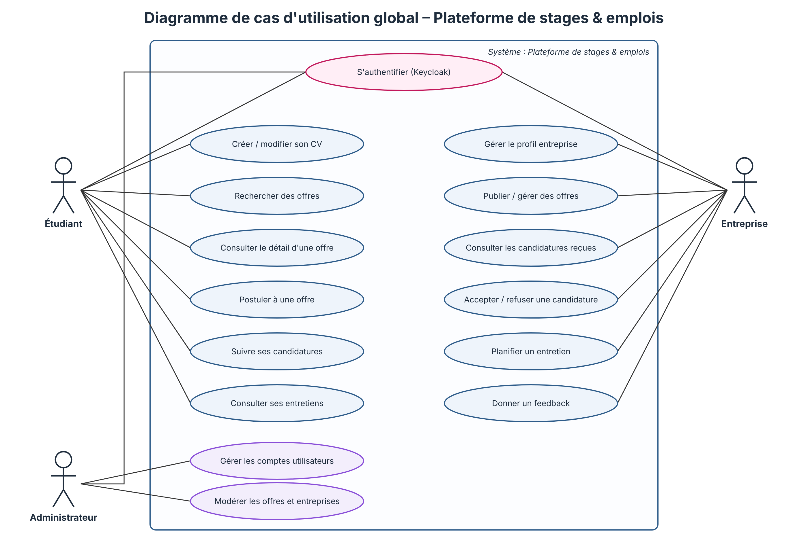
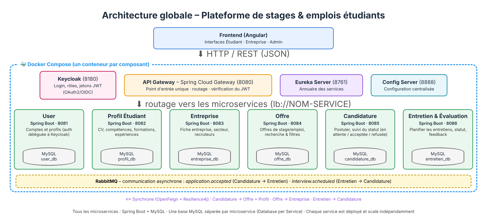

# StageLink – Plateforme de stages et d'emplois étudiants

Mini-projet du module **Architecture Web Distribuée (AWD)** – 2026/2027.

## 1. Sujet

**Problème** : les étudiants cherchent leurs stages (PFE, été) et premiers emplois sur Facebook, LinkedIn, par mail ou par connaissances. Les offres sont éparpillées, l'étudiant ne sait pas où en est sa candidature, et les entreprises reçoivent des CV par mail sans outil de suivi.

**Solution** : une plateforme web unique où les entreprises publient leurs offres, les étudiants postulent avec un CV en ligne et suivent leur candidature jusqu'à l'entretien et au feedback.

**Acteurs** : Étudiant · Entreprise · Administrateur

**Fonctionnalités principales**
1. Authentification et gestion des rôles (Keycloak)
2. Gestion du CV étudiant
3. Gestion des entreprises
4. Publication et recherche d'offres
5. Candidature et suivi du statut
6. Planification des entretiens et feedback



## 2. Équipe

| Membre | Microservice |
|---|---|
| Nom Prénom 1 | user-service |
| Nom Prénom 2 | cv-service |
| Nom Prénom 3 | company-service |
| Nom Prénom 4 | offer-service |
| Nom Prénom 5 | application-service |
| Nom Prénom 6 | interview-service |

## 3. Architecture



### Microservices

| Microservice | Responsabilité | Port | Base |
|---|---|---|---|
| user-service | Profils des comptes liés à Keycloak | 8081 | MySQL `user_db` |
| cv-service | CV de l'étudiant | 8082 | MySQL `cv_db` |
| company-service | Fiches entreprises et recruteurs | 8083 | MySQL `company_db` |
| offer-service | Publication et recherche d'offres | 8084 | MySQL `offer_db` |
| application-service | Cycle de vie des candidatures | 8085 | MySQL `application_db` |
| interview-service | Entretiens et feedback | 8086 | MySQL `interview_db` |

### Infrastructure

| Composant | Rôle | Port |
|---|---|---|
| API Gateway (Spring Cloud Gateway) | Point d'entrée unique, routage, vérification JWT | 8080 |
| Eureka Server | Annuaire des services | 8761 |
| Config Server | Configuration centralisée | 8888 |
| Keycloak | Authentification, rôles, jetons JWT | 8180 |
| RabbitMQ | Communication asynchrone | 5672 / 15672 |
| Docker Compose | Conteneurisation de l'ensemble | – |

### Communication

- **Synchrone (REST + OpenFeign)** : quand l'appelant a besoin de la réponse pour continuer (ex. interview → application : la candidature est-elle acceptée ?). Protégée par un circuit breaker (Resilience4j).
- **Asynchrone (RabbitMQ)** : pour annoncer un fait (`application.accepted`, `interview.scheduled`, `company.deactivated`).
- **Database-per-Service** : aucune base partagée, chaque service ne garde que les identifiants des données des autres.

### Stack technique

Spring Boot 3 · Spring Cloud (Gateway, Eureka, Config, OpenFeign) · Resilience4j · MySQL · Keycloak · RabbitMQ · Swagger (springdoc-openapi) · Docker · Angular

## 4. Structure du dépôt

```
Backend/          un projet par microservice + gateway, eureka, config
Frontend/         application Angular
Documentation/
  Diagrams/       use case, architecture, diagrammes de classe
  Presentation/   support de présentation
  Services/       documentation technique de chaque microservice
README.md
```

## 5. Lancement

Prérequis : Java 17, Maven, MySQL, (Docker pour Keycloak et RabbitMQ).

Ordre de démarrage :
1. MySQL
2. Config Server (8888)
3. Eureka Server (8761)
4. Keycloak (8180) et RabbitMQ (5672)
5. Les microservices (8081 → 8086)
6. API Gateway (8080)
7. Frontend

Lancer un microservice :
```bash
cd Backend/interview-service
mvn spring-boot:run
```

Documentation Swagger de chaque service : `http://localhost:<port>/swagger-ui.html`

## 6. Gestion de projet

Suivi des tâches : [lien du tableau Trello / GitHub Projects](#)
